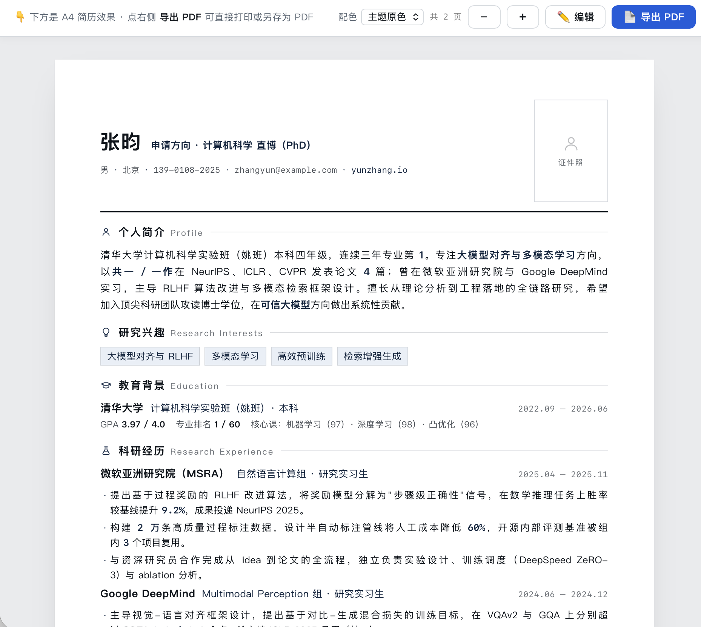
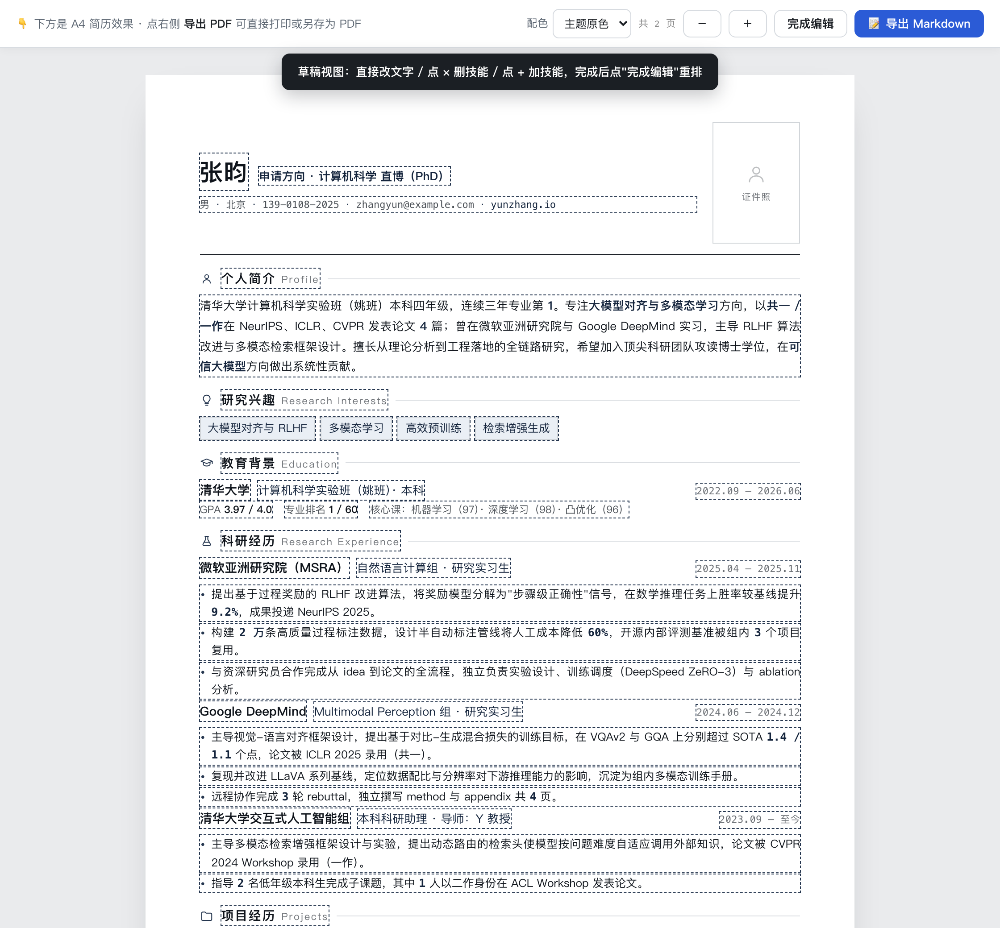
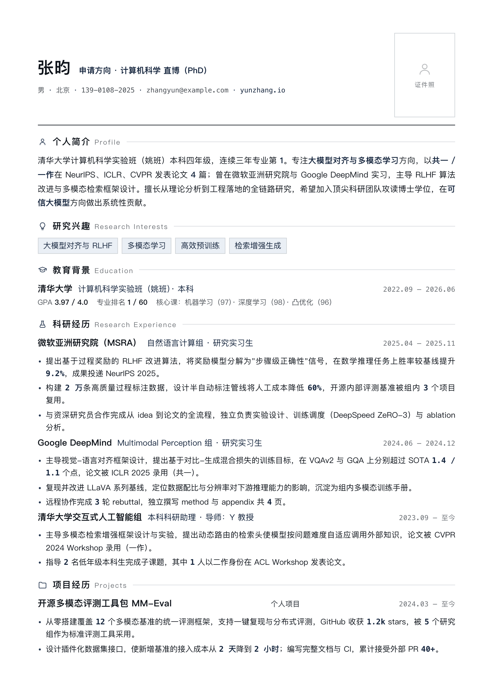
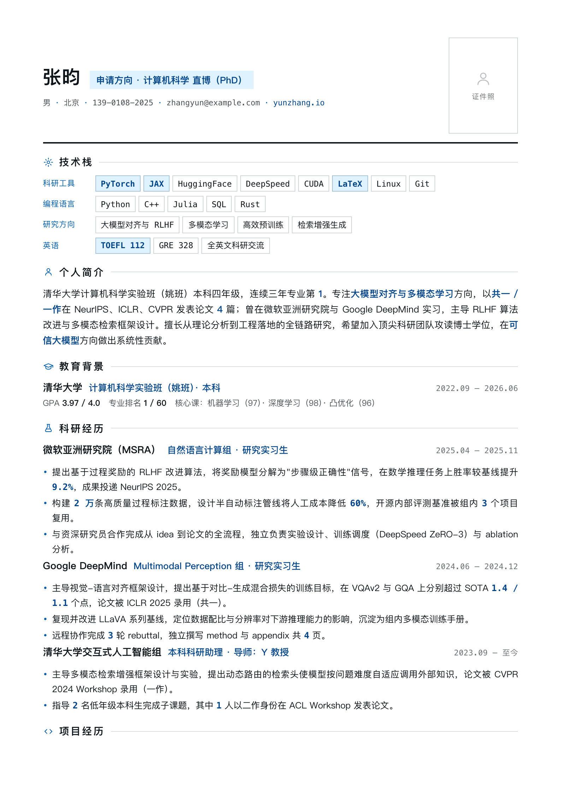
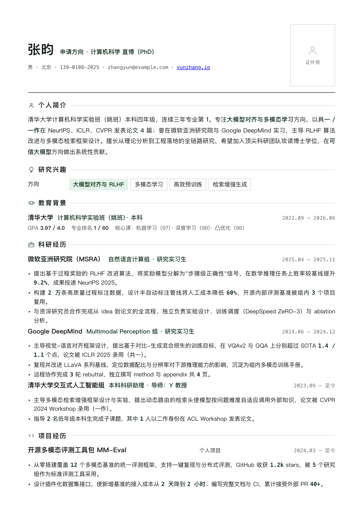
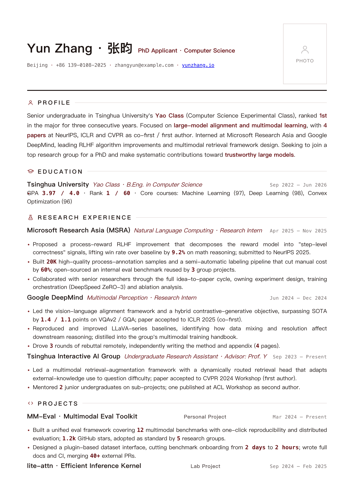
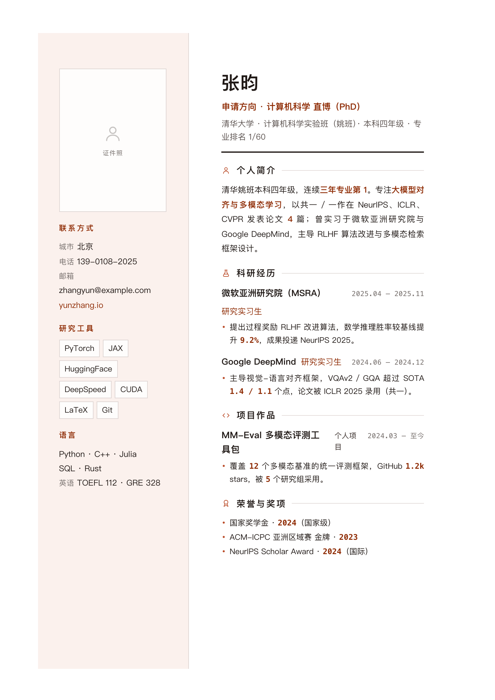
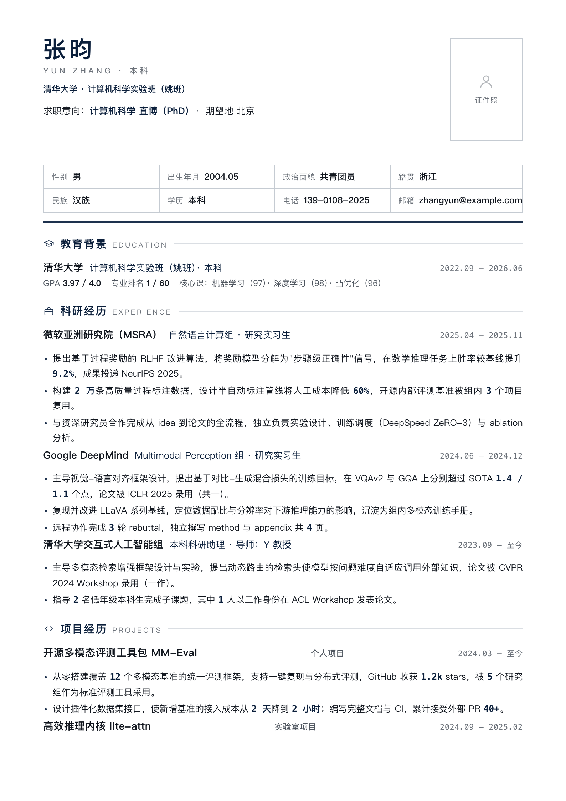
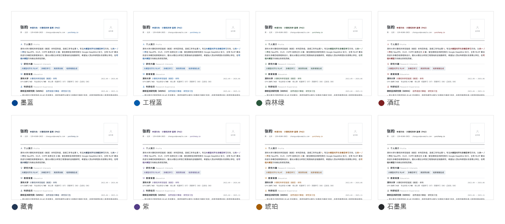

# amlei-resume

求职材料最浪费的地方，是每投一个方向，都要把自己重讲一遍。

这个仓库包含两个独立的 [Agent Skill](https://agentskills.io)：

- **amlei-resume**：维护职业画像与证据，按目标岗位产出可投递简历和 A4 PDF。
- **amlei-portfolio**：从真实项目中选案例、组织证据，为每个求职方向产出可发布的作品集 Markdown。

两个 Skill 有独立入口与 reference 契约，一起打包。作品集运行数据归属于简历数据根下的 `portfolio/`，素材跨方向共用；不再单独维护一个与简历平级的作品集目录。

## 简历 Skill：amlei-resume

三个词：**记得住、分得清、管到底**。

- **记得住**——你聊过的经历、项目、能力沉淀成跨会话画像 `profile.md`；长文、导出、项目文档等原始证据留在 `materials/`，确认后的事实再进画像。下次打开，不用从头讲起。
- **分得清**——「做过什么」是事实，全局只记一遍；「怎么讲」是强调，每个求职方向各有一版。换岗不是重写，是重新选材。
- **管到底**——从按需岗位调研、挖素材、写改，到导出矢量 A4 PDF、生成招聘平台招呼语，一条流程走完。

## 作品集 Skill：amlei-portfolio

作品集不是简历加长版，也不是项目截图合集。它面向通过初筛后的深入阅读，重点证明问题判断、产品取舍、交付结果与证据边界。

`amlei-portfolio` 按简历方向维护项目案例与公开信息，通常输出 2-5 个主案例。每个案例回答：为谁解决什么问题、本人负责什么、做了哪些关键判断、形成了什么交付、结果如何、证据在哪里、边界是什么。

## 核心设计：一份画像，多个方向，每个方向一个当前版本

```
简历数据根：.amlei-skill/resume/ 或 ~/.amlei-skill/resume/
profile.md（跨会话画像）
  已确认的短事实——经历、项目、能力
        ↑ 提炼
materials/（跨方向证据池）
  原始素材、来源、版本与待确认信息
        ↓ 投影
identities/{方向}/简历.md
  这个方向怎么选材、怎么组织、怎么措辞
        ↓ 导出
export/（预览 HTML、A4 PDF、长图）

portfolio/
  {identity-id}-作品集.md（该方向内容与证据的唯一源）
  assets/（跨方向共用素材）
        ↓ 发布
  飞书在线版本
```

判断标准只有一个：**两次不同方向的面试里，这件事你会讲得不一样吗？** 不会变的事实进 `profile.md`，证据留在 `materials/`；会变的表达属于某一份简历。

## 记忆：像 ChatGPT Memory 一样自然衔接

`profile.md` 只有五段事实，短到能一眼看完（另加一个可选的 `materials/index.md` 指针）：

```markdown
# 关于我
- 姓名 / 城市 / 联系方式 / 教育 / 链接

# 经历与项目
## 机构 | 角色 | 时间
- 做过什么，结果如何（带数字/证据）

# 能力与证据
- 能力：由哪个项目/成果证明

# 跨方向偏好
- 长期方向 / 明确排除 / 稳定工作偏好 / 通用表达偏好

# 待确认
- 下次要问的缺口、待核实数字
```

具体投递方向的目标岗位、行业/公司、城市、层级与 JD 基准属于该方向的 `target.json`，不混进 `profile.md`。

记忆怎么用：

- 每次开聊先读 `profile.md`，把它当作已经知道的用户信息，不重复问。
- 用户给文章、导出、项目文档或长口述时，先落进 `materials/` 并登记索引；只有确认后的短事实才提升进 `profile.md`。
- 聊到新东西，用三问判断值不值得记：**未来的简历会用到吗？有证据吗？换个方向也不会变吗？**
- **简历定稿是最大的记忆来源**：从 0 写简历时，定稿本身就是一份完整信息——把里面首次出现的客观事实、成果、偏好回写 `profile.md`，下次不用重讲。
- 保持短小：重复、过时、被取代的内容合并或删除；它是画像，不是聊天记录。

## 写简历的过程

你跟它聊。聊目标方向、聊做过的事、聊那些你自己都没当回事的细节——它会带着推理去读你给的资料，把疑点追问出来，而不是照单全收。聊出的客观事实经你确认后进入 `profile.md`。

也可以直接丢一份旧简历（.docx / .pdf）进来，它负责解析、重排模块、抽出证件照，转成能继续打磨的底稿。

需要了解目标岗位的行情时，它会联网搜索薪资、能力要求、行业趋势，产出市场报告，作为选材和定位的依据。

每一步都有人工卡点：**你没说「可以」之前，它一个字也不会写进你的简历。**

## 导出效果：矢量 A4 简历 PDF

一份简单的 Markdown，渲染成矢量 A4 简历，所见即所得：



> 想看 PDF 版？打开 [A4 预览 PDF](assets/张昀-计算机科学直博%20·%20简历%20A4%20预览.pdf)。

源文件就是朴素的 Markdown——模块顺序即简历顺序，写完选主题、一键导出：

```md
# self-intro

name: 张昀
role: 申请方向 · 计算机科学 直博（PhD）

# 科研经历

## 微软亚洲研究院（MSRA） | 自然语言计算组 · 研究实习生
date: 2025.04 — 2025.11

- 提出基于过程奖励的 RLHF 改进算法……
```

预览页还能就地改：改字、删加技能条，自动重排分页，改完一键导回 Markdown：



六套主题，同一份内容换皮：

| 学术 / 科研 | 技术密排 | 内容运营 |
|:--:|:--:|:--:|
|  |  |  |

| 外企 / 英文 | 侧栏创意 | 国企 / 正式 |
|:--:|:--:|:--:|
|  |  |  |

> 整页预览：[学术 / 科研](assets/theme-samples/academic.html) · [技术密排](assets/theme-samples/tech-dense.html) · [内容运营](assets/theme-samples/content-green.html) · [外企 / 英文](assets/theme-samples/english-mnc.html) · [侧栏创意](assets/theme-samples/sidebar-creative.html) · [国企 / 正式](assets/theme-samples/soe-formal.html)

同一份简历还能换 **8 套点缀配色**，预览页选好，导出 PDF 沿用：



## 作品集怎么写

作品集是单文件产物，定位、案例、结果、证据和发布信息都写在对应方向的 `{identity-id}-作品集.md` 中。默认结构是：

```text
.amlei-skill/resume/portfolio/
├── ai-pm-作品集.md
├── ai-agent-作品集.md      # 有其他方向时才创建
└── assets/{images,videos,documents,diagrams}/
```

素材跨作品集方向共用，使用稳定项目 ID 命名，并在 Markdown 中通过相对路径或公开 URL 引用。未脱敏的客户信息、内部系统和业务数据不会进入公开版本。

作品集数据优先放在当前项目的 `.amlei-skill/resume/portfolio/`；当前工作区没有 `.amlei-skill/` 时，回退到 `~/.amlei-skill/resume/portfolio/`。作品集不提供 HTML、PDF、长图或其他本地导出，发布只面向飞书等在线载体。

## 两个 Skill，各有完整工作流

`amlei-resume` 负责简历：记忆底座 `profile.md` + 多方向简历 + 按需岗位调研 + 预览导出。
`amlei-portfolio` 负责作品集：在简历数据根下按方向组织公开信息、案例、证据、共用素材与发布信息。

两个 Skill 都遵循开放的 Agent Skill 目录结构，可由支持该格式的 AI 助手按需加载。

内部结构：

- `skills/amlei-resume/SKILL.md`：简历工作流
- `skills/amlei-resume/references/`：简历格式、材料、筛选、包装、调研、导出与主题
- `skills/amlei-resume/scripts/`：预览壳、页数检查、长图与证件照
- `skills/amlei-portfolio/SKILL.md`：作品集工作流
- `skills/amlei-portfolio/references/portfolio-format.md`：案例、Markdown、素材与发布规范

## 上手

**1. 安装**（以 Claude Code 为例）

```sh
claude plugin add amlei/amlei-resume
```

**2. 开聊**。一句话就能开始——

- 「做了三年后端，想转 AI Agent 方向，这是我的旧简历，帮我重新讲一版。」
- 「帮我看看 AI Agent 开发在北京的行情，再按这个方向改一版简历。」
- 「简历定稿了，导出 A4 PDF，再帮我写几条招聘平台的开场白。」
- 「把我的项目重做成 AI 产品经理作品集，重点讲产品判断和证据。」
- 「检查这份作品集缺哪些信息，并把项目案例重新组织。」

更建议把目标、经历、材料来源一次说全，它就能照着画像开工。说漏了也没关系，细节是边聊边冒出来的。

## 几条较真的原则

- **能力必须有证据**——简历与作品集中的每条强结论，都要能指回真实项目、结果或公开材料。
- **写「做到什么」，不写「怎么做到的」**——bullet 落在结果，做法细节是面试官的常识，写出来只会稀释重点。
- **事实更新只提醒，不动你的文案**——底层事实变了，它标记出来等你决定，绝不自动改写你敲定的措辞。
- **记忆只记事实，不记措辞**——简历和作品集的组织方式不写回事实档案。
- **定稿即沉淀**——首次出现的客观事实、成果和边界会回写各自的资料库，下次不用重讲。

## 依赖

核心流程只依赖 Agent 自带能力；脚本为可选增强：

| 脚本 | 用途 | 依赖 |
|------|------|------|
| `wrap_preview.py` | 把简历正文包进 A4 预览壳 | 仅 stdlib |
| `export_long_image.py` | 导出简历长图 | `playwright` + `Pillow` |
| `extract_avatar.py` | 从旧简历提取证件照 | `opencv-python` + `numpy` |

## 许可

[MIT](LICENSE) © amlei
